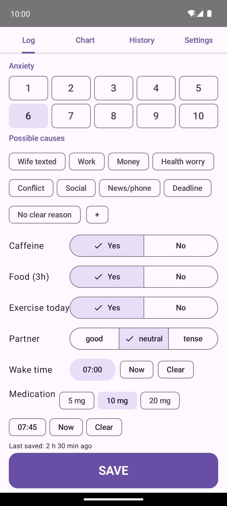
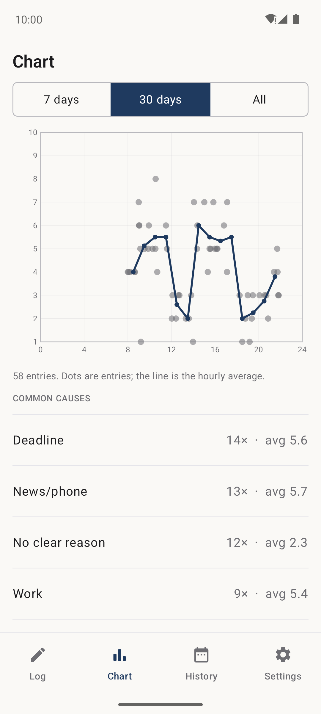
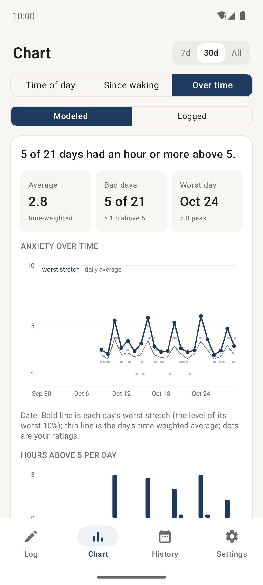
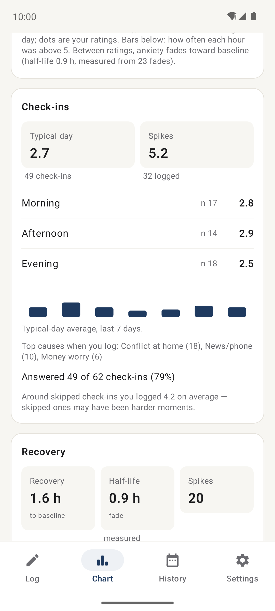
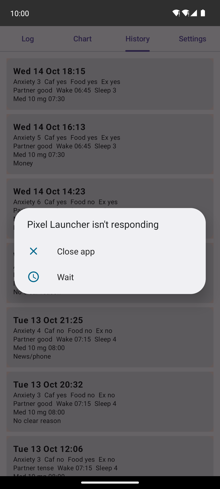
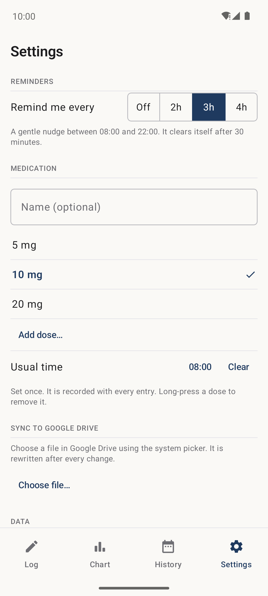

# bcalm

A low-friction anxiety and trigger logger for spotting patterns in your day.

## Install

Download the latest build: **[bcalm-release.apk](https://github.com/dreamins/bcalm/releases/download/latest/bcalm-release.apk)** (signed; future builds install over it as updates and keep your data).

A debug build is also available: [bcalm.apk](https://github.com/dreamins/bcalm/releases/download/latest/bcalm.apk).

Open it on your Android phone. You will need to allow "install unknown apps" for your browser (Android will prompt you). Android 8.0+.

## Features

- **Tap to log.** Tap a number on the Log screen and the entry is saved at once, with everything carried over from last time. Any other change on the Log screen (caffeine, food, partner, causes, Today fields, joy) also logs an entry right away, with an Undo bar. If no anxiety number was tapped, the entry is saved without an anxiety level (it never copies the previous one).
- **Edit window.** For about two minutes after a log, further changes update that same entry instead of creating a new one. Only the open entry's values are shown as selected.
- **Today card.** Wake time, sleep quality, exercise, night sweats, alcohol and cannabis, with plain labels. The card resets at midnight.
- **Night sweats** are answered in the morning. **Alcohol** and **cannabis** are for the day you log them. The Chart tab compares night sweats with the evening before.
- **Medication dose** is picked on the Log screen (under Today) and carries over until you change it; it is recorded with every entry. Name, unit and usual time are set once in Settings.
- **Joy (optional, 1-5).** A second scale for how much a positive moment landed, from "Barely" to "Really landed". Log it only after something good. It does not carry over.
- **Joy on the Chart.** Shows the joy average and a table per medication dose of average anxiety and joy, to tell "calm" (anxiety down, joy holds) from "flat" (anxiety down, joy drifts low).
- **Causes** (Work, Deadline, News/phone, No clear reason, ...) that you can add to or remove in Settings.
- **Top causes on the Log screen.** The top 6, ranked by recent use (recent uses count more). Joy entries rank causes separately. "More causes (N)" opens the full ranked list with use counts.
- **Calm pop-up.** The moment you log 6 or more (for 30 minutes, with no extra taps) a bottom sheet "A calmer moment" opens: tap the causes it is about (the same top causes as the Log screen, updating the entry) and your own calm thought and one small step appear right below. "Breathe" and "Ground" open a short guided exercise, and "How is it now?" re-rates, shows e.g. "6 → 4" and is saved with the entry (`after`, plus which tools you used). Swipe it away and a quiet "A calmer moment ›" line under the Anxiety scale reopens it; "Not now" dismisses it.
- **Calm cards and support.** In Settings, tap a cause to write its calm thought and step, and optionally mark it to show support options. A Support section holds a crisis number (prefilled, editable), a second contact and a free-text step; they appear in the pop-up at 8 or above or for marked causes, and the numbers open the dialer (no call permission).
- **Random check-ins.** Three notifications a day, each at a random time inside a window you set (morning, afternoon, evening; they auto-dismiss), rated in one tap, or skip. They replace the old every-few-hours reminder. Why: if you only log when you feel bad, the picture is biased toward your worst moments; check-ins sample your ordinary moments too, so "typical day" and baseline are honest. Pause them for 1, 3 or 7 days in Settings.
- **Follow-ups.** After you log 5 or more, a few quick check-backs (30 min, 1.5 h, 4 h) show how the moment fades. They stop once you're back near baseline, and can be switched off in Settings.
- **"Earlier today…"** logs a moment you only now got to write down, at the time it happened. It adds a point to the curve but never counts as a baseline, spike or check-in value.
- **"What helped?"** When a re-rating on the calm card (or a follow-up) shows it easing, an optional step asks what helped (tap causes such as a walk or a friend call, or add one) and how much it lifted you; that is saved as a joy entry.
- **Calm intro.** A slow, one-time welcome (a breathing circle and a few soft lines, skippable) that says none of this is required. A shorter version appears once after an update that adds something new.
- **Home-screen widget.** A row of 1-10 buttons logs an entry with carried-over values, without opening the app.
- **Insights chart.** Three views: Time of day, Since waking (hours after your wake time) and Over time. Entries keep the local time where they were logged, even after travelling.
- **Modeled curve (default).** Ratings are points; between them anxiety is modeled as fading toward your baseline (from check-ins when you have them), so each day becomes a continuous, time-weighted curve and the numbers are not skewed by when you chose to log. It shows the average day in bold, every day as a faint line (red when the day had an hour or more above 5), and a "> 5" strip of how often each hour was above 5. A plain sentence names when hard moments most often hit. Over time shows each day's worst-stretch line (the level of its worst 10%) with its time-weighted average, the average, hours above 5 per day and "bad days" (an hour or more above 5).
- **Modeled / Logged toggle.** "Logged" switches the same views to plain averages of what you entered (hourly bars, percentile lines, single entries as dots).
- **Check-ins and Recovery cards.** Check-ins: typical day (from random check-ins) next to the average of what you logged yourself, by morning/afternoon/evening, the last seven days, and your answer rate. Recovery: how long hard moments take to get back near baseline, the fade half-life (measured once there are enough fades), and whether a coping tool made it quicker.
- **Patterns** by cause and factor (caffeine, food, exercise, partner, sleep, alcohol, cannabis) as differences from your average, read off the curve.
- **History** grouped by day, with notable details only and swipe-to-delete (with Undo).
- **Settings** hold the check-in windows (set start and end for each), pause, the follow-up switch, medication, causes and calm cards, support and sync.
- **Check for updates** in Settings, a manual button that compares your installed version with the latest release and links to the download. Nothing is checked unless you tap it.
- **Light and dark theme** follow the system setting, in a classic, neutral look.
- **CSV export and import** (restore history after reinstalling), and **auto-sync to Google Drive** via a file you pick once ("New file…" creates one; "Use existing file…" points at an existing bcalm CSV and merges it in). Sync is two-way: changes made to the file elsewhere are merged in on the next sync (at app start, on resume and after each change); the file wins for edited entries and calm cards, and deletions made elsewhere aren't applied.

## Screenshots

| Log | Chart | Over time |
|---|---|---|
|  |  |  |

| Check-ins and Recovery | History | Settings |
|---|---|---|
|  |  |  |

The screenshots use generated, anonymous demo data.

## CSV columns

`timestamp,date,time,anxiety,caffeine,food_3h,exercise_today,partner,wake_time,sleep_quality,med_dose,med_time,causes,med_unit,med_name,night_sweats,alcohol,cannabis,utc_offset,joy,after,tools,source,prompt_id`

`med_dose` is a number (e.g. `7.5`) with its unit in `med_unit` and the medication name (if set) in `med_name`. Booleans are `1`/`0` (empty if unset), `partner` is good/neutral/tense, and multiple causes are separated by `;`. `utc_offset` is the UTC offset in minutes where the entry was logged (empty in older files). `joy` is 1-5 (empty if not logged). `after` is 1-10, the anxiety re-rated on the calm card (empty if not used), and `tools` lists what was used, `;`-separated: `card`, `breathe`, `ground`. `source` is `manual` (default, also when empty), `prompted` (answered random check-in), `followup` or `recalled` ("Earlier today…"); `prompt_id` links a prompted or follow-up entry to its `#prompt` row. Files from older versions without these columns still import (every entry is `manual`). `timestamp`, `date` and `time` are in that local time, so entries keep the time of day where they were logged after you travel.

Check-in prompts, calm cards and support contacts are included as `#`-prefixed rows after the entries. Import and sync restore them (import only where the same item is not already set on the device; sync lets the file win); older versions of the app skip these rows.

- `#prompt,<id>,<scheduled ISO time>,<status>,<window>` is one scheduled check-in: `<id>` like `p20261029-1` (random check-in) or `f202610291430-0` (follow-up), `<scheduled ISO time>` with offset (`2026-10-29T14:30:00+02:00`), `<status>` one of `pending`, `answered`, `skipped`, `expired`, and `<window>` 0-2 for the morning/afternoon/evening check-in or 10+ for follow-ups. These rows come before `#card` and `#support`; on merge the more final status wins (answered over skipped over expired over pending), and older versions skip them.
- `#card,<cause>,<calm thought>,<what to do>,<1 or 0 for support options>` adds or replaces the card for a cause (the cause is added to the list if missing). The last field is optional and `1` shows the support options for that cause.
- `#support,<key>,<value>` sets a support field. Keys: `crisisLabel`, `crisisNumber`, `personLabel`, `personNumber`, `customStep`.

Text fields are either percent-encoded (what the app writes, e.g. `Take%20a%20walk`) or double-quoted (`"It's ok, really"`, with `""` for a quote inside); plain text without commas, quotes or `%` also works. Example: `#card,Work,"It's ok, really",Take a short walk,0`.

## Privacy

All data stays on your device unless you export it or turn on sync to a file you chose (the Drive app does that upload, not this app). The only network call the app makes is the manual "Check for updates" in Settings.

## Build

```
./gradlew assembleDebug
```

The APK is written to `app/build/outputs/apk/debug/`. GitHub Actions ("Build APK") builds every push and publishes the `latest` release from `main`.

To refresh the screenshots, run the **Screenshots** workflow from the Actions tab. It boots an emulator, seeds anonymous demo data (`.github/scripts/seed_demo.py`), captures the log, chart (time of day, over time and the cards), history and settings screens and commits the images to `docs/screenshots/`.

Tools that edit the synced file should update it in place (same file), not upload a replacement or delete and recreate it, or the phone loses the link and shows "Sync file missing or no access".
